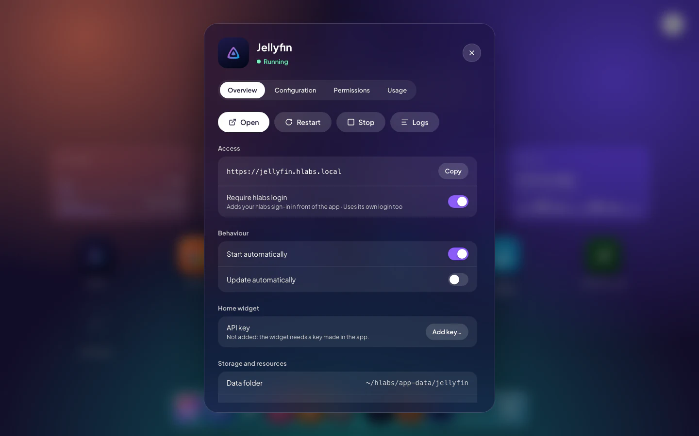

For admins. Members can open the apps an admin shared with them, but not change them.

## Open App settings

Open an app and choose **App settings** at the top of its window; the settings open over the window, which stays as it was. The settings show the app's name, whether it's running and how long it has been up, such as "Running · up 6 days". Choose **Close** to go back to where you were.

## The app's address

Under **Access**, App settings shows the app's address, such as `https://vaultwarden.hlabs.local`. Select it to open the app in a new tab, or choose **Copy** to copy it for another device or a bookmark.

If hlabs can't announce the app's name on your network, the address is the hlabs address with the app's own port, such as `https://hlabs.local:12003`. It opens the same app.

**Require hlabs login** puts your hlabs sign-in in front of the app, so only people you've shared it with get in. It's on for most apps. Apps that have their own accounts say "Uses its own login too": people sign in to the app as well. If you turn the switch off, hlabs asks first, because anyone who can reach the app's address then sees the app's own sign-in page, and members you haven't shared it with are no longer kept out. The change applies at once; the app doesn't restart.

**Public on the internet** lets people who aren't on your tailnet open the app at a name under your own domain, such as `https://photos.example.com`. Once Cloudflare Tunnel is set up in Settings › Network & remote access, choose **Make public…**; until then, the row says to set it up first. A public app shows a **Public** badge, with its address, **Visits**, **Change…** and **Make private**. See [Make an app public](/help/remote-access/make-an-app-public/).

## Choose how an app behaves

Under **Behaviour**:

- **Start automatically**: the app starts when hlabs starts, for example after this computer restarts. Turn it off for apps you only use now and then; they stay stopped until you start them.
- **Update automatically**: hlabs installs the app's new versions overnight, between 3 and 5 am, when **Update apps automatically** is on in Settings › Updates. A version that asks for new access waits for you in the App Store's Updates. Apps you deployed yourself never update by themselves. While an app is public, this stays on and reads "On while *app* is public".

Each switch saves as soon as you change it. If it can't be saved, it moves back and hlabs tells you why.

An app whose Home widget needs an API key, such as Immich's photo library, has a **Home widget** section. Make a key in the app (the section says where), then choose **Add key…** and paste it. hlabs keeps it in this computer's keychain and uses it only to read the widget's figures; **Remove** deletes it.

## Storage and version

Under **Storage and resources**:

- **Data folder** is where the app keeps its data, such as `~/hlabs/app-data/vaultwarden`.
- **Using now** is how much disk the app takes, its data and its software together, such as "Disk 210 MB". It's counted every few minutes, so it may lag a little behind.

At the bottom, the version says whether it's up to date, or which newer version the App Store has.

## Change an app's settings

The **Configuration** tab of App settings has the app's settings and where it's reached.

**Environment variables** are the settings the app reads when it starts. Those that come with the app are filled in already; their names can't be changed and they can't be removed. A switch, a choice or a number field appears where the app expects one. Some are under **Show advanced**, because they're rarely changed.

- To add one, choose **+ Add variable**, then type its name in capitals (such as `SMTP_HOST`) and its value. Names hlabs sets itself (`TZ`, `PUID`, `PGID` and those starting `HLABS_`) can't be used. Turn on **Secret** for a password or key, so it's hidden like the others.
- Passwords and keys show as dots with a **secret** label. Choose the eye to show one, and again to hide it; hlabs notes in its log that you looked (never the value). To change one, type the new value; leave it empty to keep it as it is.
- Some secrets were made by hlabs when the app was installed, such as its database password. They say "Generated by hlabs": you can show and copy them, but not change them, because the app's data depends on them.

Under **Network**:

- **Web address** is the name before `.hlabs.local`, such as `vaultwarden`. Use lowercase letters, numbers and dashes. When you save a new one, the old address stops working and hlabs tells you the new one, with **Copy**.
- **Port on this computer** is the app's own port, from 12000 to 12999, which its fallback address and its tailnet address use (on your tailnet it's this port + 2000). Leave it as it is unless another program needs that port. hlabs says if the port is already in use.

Changes apply when you choose **Save and restart app**: hlabs restarts the app with them and says "Saved. <App> restarted." If the app doesn't start with the new settings, hlabs puts the previous ones back, starts it again and tells you, so a typo never leaves an app broken. **Cancel** puts back what's saved. If you switch tabs or close App settings with changes you haven't saved, hlabs asks whether to discard them.

## Choose what an app can reach

The **Permissions** tab says what the app can see. Apps only see what you allow here, and changes take effect when the app restarts.

**Folders** lists the folders the app can use, such as "Home › Documents" or "NAS › Backups", whether it can only read them or also change them, and what the app uses them for. Turn a folder's switch off to take it away; folders the app can't work without stay on, but **Change…** lets you pick another folder for them. To give the app another folder, choose **+ Give access to a folder**, pick it, then choose **Read only** or **Read and write**. Inside the app, it appears as `/mnt/hlabs/<folder name>`. A folder on a network drive that isn't connected says **Not connected**.

**Devices** lists the USB adapters and other hardware the app asked for when it was installed. It says so when it asked for none.

Under **Network**:

- **Reach the internet**: turn it off and the app can't open connections outside this computer, not even to your home network. You can still open it as before.
- **Talk to other apps**: turn it off to keep the app apart from your other apps, so they can't reach it.

New apps start with what they say they need. Apps that work with devices on your home network, like Home Assistant, start with **Reach the internet** on, because turning it off would cut them off from those devices too. Folder and network changes apply together when you choose **Save and restart app**, and are undone the same way if the app doesn't start.

## See what an app uses

The **Usage** tab of App settings shows how much the app uses, so you can tell whether it's the one slowing things down:

- **CPU** is its share of this computer's processor right now, with its average since midnight, such as "avg 0.4% today".
- **Memory** is how much it uses now, with its highest in the last 24 hours, such as "peak 91 MB".
- **Disk** is its data and its software together, such as "210 MB · data + image".

These follow the app every 5 seconds while the tab is open.

Below them, a chart shows the last 24 hours. Choose **CPU**, **Memory** (the default) or **Network** above it; Network draws what the app downloads (In) and uploads (Out). The chart moves on each minute. Where the line breaks, the app wasn't running. Point at the chart or select it and use the arrow keys to read the time and value at any point. A newly installed app shows "Collecting data — check back in a few minutes." for its first 10 minutes.

**Containers** lists each part of the app, such as `vaultwarden-server`, with its memory, CPU and current download rate, such as "64 MB · 1% CPU · ↓ 1 KB/s". A part that isn't running says **Stopped** (the app is stopped) or **Exited** (it ended on its own while the app runs). Choose a part to open the app's logs showing only that part's lines.

## Update an app

When the App Store has a newer version, choose **Update** beside it, here or in the App Store's **Updates**. The app restarts while it updates, and the top of App settings says how far it has got, such as "Updating… 40%". Your settings and data stay as they are.

If the new version doesn't start, hlabs puts the previous version back and starts it again, so an update never leaves an app broken. Admins get a notification, and the app's page in the App Store says "<App>'s update didn't start, so hlabs rolled it back". From there:

- **View log** opens the app's logs at the moment the update failed, so you can see why.
- **Try again** runs the update again, for example after the app's makers publish a fix.
- **×** dismisses the message. It doesn't come back for that update.

In the rare case the previous version doesn't start again either, the app shows an error and the message says it couldn't be restored. Check its logs.

## When an app stops working

hlabs keeps an eye on your apps while they run. If one crashes and doesn't come back by itself within 30 seconds, keeps crashing (3 times in 5 minutes), or stops answering for a minute, hlabs marks it as not working: its tile on Home shows **Error**, and admins get a notice such as "Uptime Kuma stopped working" with what happened. Choose **Restart** to start it again, or **View logs** to see why. Your data stays as it is.

Short hiccups that fix themselves within a few seconds don't count, and neither does anything you do yourself, like stopping, restarting or updating an app. If an app comes back by itself and keeps working for a minute, hlabs says "Uptime Kuma is working again". Family members aren't told; they see that the app isn't running if they try to open it.

## Reinstall an app

If an app keeps failing, even after a restart, reinstall it. hlabs downloads the same version again and sets it up from scratch, but keeps everything that's yours: its data and settings, the passwords it created, its folder access, who it's shared with, and its place on Home and in the Dock.

Choose **Reinstall…** in the app's logs or App settings when it has stopped working, or from its tile's menu on Home. For an app that runs but misbehaves, **Reinstall…** is at the bottom of App settings, next to **Uninstall…**. hlabs says how much it downloads before you confirm. While it reinstalls, the tile and App settings show how far it has got; anyone opening the app is told it's being reinstalled.

If hlabs can't find the app's saved settings, it won't reinstall it, because the app's passwords would be reset. Uninstall it and install it again instead. **Reinstall…** also waits while the container engine is stopped, while your apps are paused from the menu bar, or while hlabs is busy with something that can't be interrupted.

## Read an app's logs

Logs are what an app writes about what it's doing. They help when something goes wrong, for example when an app won't start. Choose **Logs** in App settings or at the top of the app window. The back button at the top returns to where you opened them: App settings, or the app. Logs you reached another way, such as from a broken app's tile or a notice, go back to the app's settings, and **Close** there takes you back to where you started.

The logs show the latest 500 lines, oldest first, with the time and, when the app says, how serious each line is: INFO, WARN, ERROR or DEBUG. New lines appear as the app writes them while **Following** is on. Scroll up to read earlier lines and following stops; choose **Following** again to jump back to the newest line. If the app restarts while you watch, a "Container restarted" line marks where.

To find something, type in **Filter** to show only lines that contain it, choose **Errors only**, or, for an app made of several parts, pick one under its name (such as "server"). **All** mixes every part's lines in time order and starts each line with whose it is. If nothing matches, choose **Clear filters**.

To keep a copy, for example to attach to a bug report, choose **Download**. The file has every line the app has kept (up to about 30 MB for each part), for the part you picked or for all of them, even while a filter hides some lines on screen.

Logs can contain passwords and other private details, so only admins can see or download them.

## Uninstall an app

At the bottom of App settings, choose **Uninstall…**. hlabs asks what happens to the app's data:

- **Keep its data** (the default): the app is removed, but its data stays on this computer. Install it again later and it picks up where you left off, with the same passwords.
- **Delete its data too**: its data is removed as well, and hlabs says how much. This can't be undone.

If another app needs this one (Immich needing a database app, for example), hlabs says so, and you uninstall that app first.

After you choose **Uninstall**, you're back on Home, where the app shows "Removing…" until it's gone and hlabs says it was uninstalled. It also leaves everyone's Home screen and Dock, and the apps shared with members. Backups made earlier are kept. If something goes wrong, the app shows an error and hlabs offers **Try again**.

## Start, stop or restart an app

- **Open** opens the app in a new tab.
- **Restart** stops the app and starts it again. Try this first when an app misbehaves.
- **Stop** stops the app until you start it again, even after this computer restarts. Its data stays where it is.
- **Start** appears instead of Stop when the app is stopped.
- **Logs** shows what the app has been writing, to help work out what went wrong.

While an app starts, stops or restarts, the buttons wait until it's done. If it doesn't come back, hlabs says "<App> didn't start. Check the logs." with a way to its logs.

If the container engine has stopped, these buttons are turned off until it's running again.
