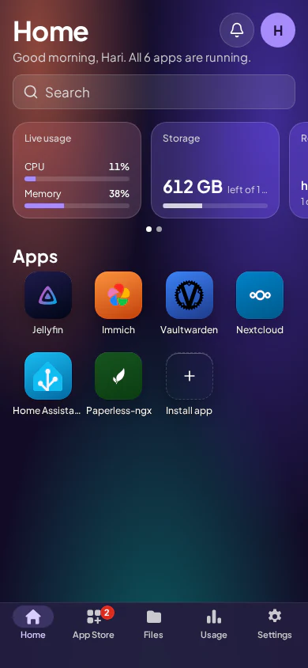
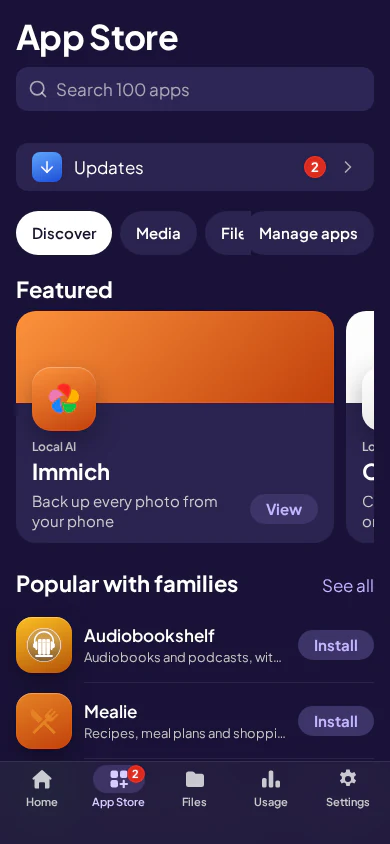
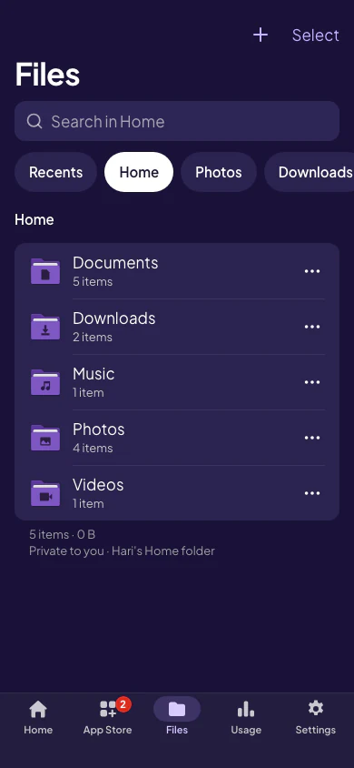
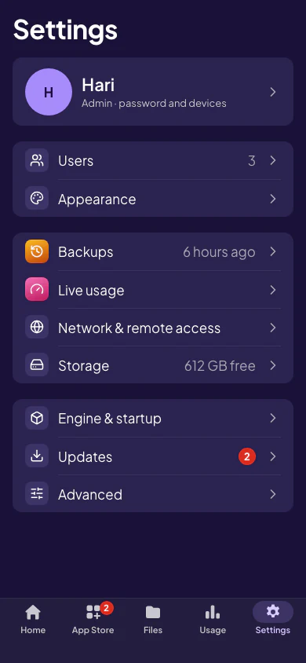

For everyone who uses hlabs.

Open hlabs in your phone's browser, at home on `https://hlabs.local` or anywhere on your tailnet address (see [Remote access](../../remote-access/tailscale/)). On a screen narrower than a tablet, hlabs looks and works like an app made for the phone.

## Move around

The **tab bar** at the bottom of the screen has **Home**, **App Store**, **Files**, **Usage** and **Settings**. The tab you're on is in your accent colour with a soft highlight behind it. When app updates are waiting, **App Store** shows how many. People who aren't admins see **Home**, **Files** and **Settings**, plus **App Store** and **Usage** if an admin allows them.

Tap the tab you're already on to go back to the top of the page; in **Files** it also goes back to the top folder of where you are.

Each main page starts with its name in large letters. As you scroll, the name moves into a small bar at the top. Pages you go into, such as an app in the App Store or a section of Settings, have a back button at the top named after where you came from, such as **‹ App Store** or **‹ Settings**. Your browser's back button and the swipe-back gesture do the same.

## Sheets

Things that open over a page, such as installing an app, an app's settings, your notifications and questions like "Uninstall Jellyfin?", slide up from the bottom as a **sheet**. To close one, drag it down by its top edge, tap the dimmed page behind it, tap **✕** or **Cancel**, or use your browser's back button. Once you've changed something in a sheet, it doesn't close when you drag it or tap behind it, so you don't lose what you typed: tap **Cancel** instead.

## Home

Home shows a greeting and whether your apps are running, with your notifications and your account at the top right and **Search** under them. Search finds apps, files and settings (see [Your Home screen](../home/#search)); tap **Cancel** to go back.

Your widgets sit in a row you can swipe sideways, two at a time, with dots underneath showing where you are. Tap a widget to open what it shows.

Your apps are below, four to a row. Tap an app to open it in a new browser tab; hlabs stays open where you left it. If an app isn't running, an admin's tap opens its settings so they can start it or see what's wrong; others are told whom to ask.

Admins can touch and hold an app for half a second to see its menu: **Open**, **Settings**, **Logs**, **Restart** (or **Start**) and **Uninstall…**. An app's settings open as a tall sheet over the page you were on, with **Overview**, **Configuration**, **Permissions** and **Usage** across the top.

Arranging Home and adding widgets is done on a computer; your phone shows the same Home.

## The App Store

The App Store has a search field, the categories as a row you can swipe along, **Featured** apps you can swipe through, and lists of apps, each with one button: **Install**, **Open**, or what it's doing, such as **Installing… 42%**. Admins see **Updates** with a count at the top when apps have newer versions.

Tap **Install** to see what the app can access, then **Install** at the bottom of the sheet. The sheet closes and the app's button, and its tile on Home, show how far the install has got. If it fails, a sheet says why, with **Try again**.

## Files

**Files** has the same places as on a computer, as a row of buttons under the search field; **Trash** is the last one. A folder is a list: tap a row to open it, or tap **•••** at its end to open, download, rename, move or delete it. **+** at the top makes a new folder or uploads files from your phone. Tap **Select** to tick several items; the buttons along the bottom, where the tab bar was, move, share, download or delete them, and **Done** stops selecting. In **Trash**, tap the round arrow on a row to put it back, or **Restore all**. See [Files](../../files/files/).

## Live usage and notifications

**Usage** shows the time range across the screen and the tiles two to a row, with the chart and your apps under them. The bell on Home opens your notifications in a sheet, grouped into **Today** and **Earlier**, with **Mark all read** at the top.

## Settings

**Settings** lists its sections as rows; tap one to go into it, and **‹ Settings** to come back. Each section shows its settings as rows, with the current value at the right and an arrow on the rows you can tap. Things you'd change in a dialog on a computer open as a sheet.

- **Account**: your name and picture at the top, with **Edit** at the top right. Tap **Password**, **Two-factor login** or **Recovery codes** to change them; **Sign out** at the end of another device's row signs it out.
- **Users** (admins): everyone in one list with their role. Tap **•••** on a person's row for **Apps access**, **Reset password…**, **Make admin**, **Disable** and **Delete…**, or on a waiting invite for **Copy link** and **Revoke**. **Invite someone** is at the end of the list and at the top right; the invite opens as a sheet with **Member** or **Admin** side by side.
- **Backups** (admins): when the last backup ran and when the next one is, with the last ten as bars and **Back up now**, then your destinations, the schedule and **Restore…** as rows, and the recent runs. Adding a destination and a restore that's running open as sheets.
- **Updates**: **Update now** for hlabs, then each app with a small **Update** button; **Update all** is at the top right of the App Store's **Updates**.
- **Engine & startup**, **Network & remote access**, **Storage** and **Advanced** work as on a computer, laid out as rows.

## Log in

The log-in page lists the people who use hlabs (unless an admin hid the list): tap your name, type your password and tap **Log in**. Turn on **Remember this phone** to stay logged in for 30 days. Your phone's password manager can fill your details in, and with two-factor login on, your phone can suggest the code. At the bottom, the page says which address you used, such as **via Tailscale · hlabs.your-tailnet.ts.net**.

## Add hlabs to your Home Screen

You can put hlabs on your phone's Home Screen with the hlabs icon, so it opens like an app:

- **iPhone or iPad (Safari)**: tap **Share**, then **Add to Home Screen**. The first time you open Home in Safari, a card reminds you how; tap **Dismiss** and it won't show again in that browser.
- **Android (Chrome)**: open the browser menu and choose **Install app** or **Add to Home screen**.

Use your tailnet address to add it, so it works both at home and away. The Home Screen app keeps its own login, so log in once more there; **Remember this phone** is on by default. If your phone can't reach hlabs, it shows **Can't reach hlabs** with **Try again** instead of a browser error. See also [Use hlabs as an app](../use-as-app/).
